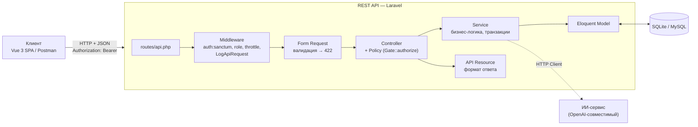

# Техническое задание

**Тема:** Цветочный магазин с конструктором букетов (вариант 28)
**Тип приложения:** REST API на Laravel + SPA-клиент на Vue 3

## 1. Описание предметной области

Цветочный магазин продаёт готовые букеты и собирает индивидуальные букеты по выбору покупателя с доставкой по городу.
Покупатель выбирает букет в каталоге (по поводу, цене, составу) или собирает свой в конструкторе: выбирает цветы,
их количество и упаковку, а система сразу считает стоимость. При оформлении заказа указываются адрес, получатель,
дата и интервал доставки, по желанию — текст открытки. Цветы учитываются на складе поштучно: при оформлении заказа
остатки списываются автоматически, при отмене — возвращаются. Флорист видит очередь заказов на сборку и отмечает
этапы работы, курьер забирает готовые заказы и подтверждает доставку. Администратор ведёт каталог, справочники
(цветы, упаковка, поводы), назначает роли и курьеров, смотрит отчёт о продажах. Приложение автоматизирует приём
заказов, учёт остатков, передачу заказа между флористом и курьером и контроль статусов.

## 2. Роли пользователей

| Роль | Доступные действия |
|------|--------------------|
| Гость | Просмотр каталога, фильтры и поиск; просмотр цветов и упаковки; расчёт цены в конструкторе; регистрация и вход |
| Покупатель (`customer`) | Всё, что гость; сохранение индивидуальных букетов; оформление заказа; просмотр своих заказов; отмена нового заказа; изменение открытки; ИИ-помощник |
| Флорист (`florist`) | Очередь заказов на сборку (`new`, `assembling`, `ready`); смена статуса «Собирается» / «Готов»; поступление и списание цветов на складе |
| Курьер (`courier`) | Готовые заказы без курьера и свои доставки; взять заказ в доставку; отметить доставку |
| Администратор (`admin`) | Всё; CRUD букетов (с фото), цветов, упаковки, поводов; управление пользователями и ролями; назначение курьера; любые допустимые смены статуса; отчёт |

## 3. Функциональные требования

1. Система должна позволять гостю зарегистрироваться (имя, email, пароль) и войти, получив токен доступа.
2. Система должна позволять пользователю выйти из системы (отзыв текущего токена) и получить данные своего профиля.
3. Система должна позволять просматривать каталог готовых букетов с фильтрацией по поводу, цветам, цвету и диапазону цены, поиском по названию, сортировкой и постраничным выводом.
4. Система должна позволять просматривать карточку букета с составом (цветы и количество) и поводами.
5. Система должна позволять собрать букет в конструкторе (цветы, количество, упаковка) и рассчитать его стоимость без сохранения.
6. Система должна позволять покупателю сохранять, изменять и удалять свои индивидуальные букеты, пока они не заказаны.
7. Система должна позволять оформить заказ из готовых и индивидуальных букетов с датой и интервалом доставки и открыткой, со списанием остатков цветов.
8. Система должна позволять покупателю просматривать свои заказы, отменять заказ в статусе «Новый» (с возвратом цветов на склад) и изменять открытку.
9. Система должна позволять флористу просматривать очередь сборки и переводить заказ в статусы «Собирается» и «Готов к доставке».
10. Система должна позволять курьеру брать готовый заказ в доставку и отмечать его доставленным.
11. Система должна позволять флористу и администратору оформлять поступление и списание цветов.
12. Система должна позволять администратору создавать, изменять и удалять букеты (с загрузкой фото), цветы, упаковку и поводы.
13. Система должна позволять администратору просматривать пользователей, менять их роли и назначать курьера заказу.
14. Система должна позволять администратору получать отчёт: заказы по статусам, выручку, средний чек, популярные букеты, заканчивающиеся цветы.
15. Система должна позволять сгенерировать варианты текста открытки и подобрать букет по запросу на естественном языке (ИИ-помощник).

## 4. Нефункциональные требования

1. Серверная часть — REST API на фреймворке Laravel 12 (PHP 8.3).
2. Формат обмена данными — JSON; ошибки в едином формате `{"message": "..."}` (валидация — дополнительно `errors`).
3. СУБД — SQLite (файл внутри проекта, без отдельного сервера); поддерживается переход на MySQL 8 изменением `.env`. Структура БД создаётся только миграциями.
4. Аутентификация по токенам Laravel Sanctum, срок жизни токена — 7 суток.
5. Пароли хранятся только в виде хеша (bcrypt); пароли и токены не попадают в ответы API и журналы.
6. Разграничение доступа по ролям (middleware `role`) и по владельцу данных (политики).
7. Операции, изменяющие несколько таблиц, выполняются в транзакциях; остатки защищены блокировкой строк.
8. Наличие документации API (коллекция Postman, таблица эндпоинтов) и автотестов.
9. Время ответа API на типовые запросы — не более 1 с при 50 одновременных пользователях.
10. CORS разрешён только для адреса клиентского приложения.

## 5. Ключевой сценарий — оформление заказа

| Шаг | Пользователь | Сервер |
|-----|--------------|--------|
| 1 | Выбирает букеты в каталоге и/или собирает свой в конструкторе, добавляет в корзину | Конструктор: `POST /custom-bouquets/calculate` — считает цену, возвращает предупреждения (мало/чётное число цветов, превышена вместимость упаковки, нет на складе) |
| 2 | Сохраняет индивидуальный букет | `POST /custom-bouquets` — проверяет правила сборки; при нарушении — **409** |
| 3 | В корзине вводит адрес, получателя, телефон, дату и интервал доставки, текст открытки; нажимает «Оформить» | `POST /orders`. Form Request: обязательные поля, формат телефона, дата не в прошлом и не дальше 30 дней, `time_to > time_from` → иначе **422** |
| 4 | — | Проверка времени: интервал в пределах 09:00–21:00, не короче 60 мин, начало не раньше чем через 3 ч → иначе **422** |
| 5 | — | Для каждой позиции: букет в продаже (иначе **409**), индивидуальный букет принадлежит покупателю (иначе **403**) и соответствует правилам сборки |
| 6 | — | `DB::transaction`: подсчёт нужного количества каждого цветка, блокировка строк `flowers` (`lockForUpdate`), проверка остатков → при нехватке **409** со списком недостающих цветов и откат |
| 7 | — | Списание остатков, расчёт суммы (доставка 2 000 ₸, бесплатно от 30 000 ₸; открытка 500 ₸), создание `orders`, `order_items`, `deliveries`, `postcards`; запись в журнал |
| 8 | Видит заказ со статусом «Новый» | **201** + заказ. Флорист видит его в очереди |
| 9 | Флорист: «Собирается» → «Готов»; курьер: «Доставляется» → «Доставлен» | `PATCH /orders/{id}/status` — проверка роли (политика, **403**) и допустимости перехода (Enum, **409**) |

Возможные ошибки: 401 (нет токена), 403 (чужой букет / недостаточно прав), 404 (букет не найден), 409 (нет цветов, букет снят с продажи, недопустимый переход статуса), 422 (ошибки валидации и времени доставки).

## 6. Диаграмма вариантов использования

```mermaid
flowchart LR
    guest([Гость])
    customer([Покупатель])
    florist([Флорист])
    courier([Курьер])
    admin([Администратор])

    subgraph Система «Цветочный магазин»
        UC1(Регистрация / вход)
        UC2(Просмотр и фильтрация каталога)
        UC3(Расчёт цены в конструкторе)
        UC4(Сохранение своего букета)
        UC5(Оформление заказа)
        UC6(Отмена заказа / изменение открытки)
        UC7(ИИ: текст открытки, подбор букета)
        UC8(Очередь сборки, смена статуса)
        UC9(Учёт остатков цветов)
        UC10(Взять заказ в доставку / доставлен)
        UC11(Управление каталогом и справочниками)
        UC12(Пользователи, роли, назначение курьера)
        UC13(Отчёт о продажах)
    end

    guest --- UC1 & UC2 & UC3
    customer --- UC2 & UC3 & UC4 & UC5 & UC6 & UC7
    florist --- UC8 & UC9
    courier --- UC10
    admin --- UC8 & UC9 & UC11 & UC12 & UC13
    UC5 -. include .-> UC3
```

## 7. Стек технологий

**PHP 8.3** — серверный язык с типизацией, перечислениями (Enum) и readonly-свойствами. **Laravel 12** — MVC-фреймворк
с маршрутизацией, middleware, валидацией (Form Request), сервис-контейнером и внедрением зависимостей, очередями
и тестированием «из коробки». **Eloquent ORM** связывает модели с таблицами, описывает связи (`hasMany`,
`belongsToMany`…), защищает от SQL-инъекций параметризованными запросами. **Composer** управляет зависимостями.
**SQLite** — встраиваемая реляционная СУБД: база хранится в одном файле проекта, не требует установки сервера и поддерживает транзакции и внешние ключи. Благодаря Eloquent тот же код работает и с **MySQL 8** (транзакции InnoDB и блокировки строк `SELECT … FOR UPDATE`), что важно для
списания остатков. **Laravel Sanctum** — лёгкая аутентификация по API-токенам (в БД хранится SHA-256 хеш токена).
Laravel подходит для задачи, так как позволяет быстро построить REST API со строгой валидацией, ролевой моделью,
транзакциями и автотестами, не изобретая инфраструктуру.

## 8. Архитектура



Путь запроса: маршрут → middleware (аутентификация, роль, журнал) → Form Request (валидация) → контроллер
(проверка политики) → сервис (бизнес-правила, транзакция) → модель Eloquent → БД → API Resource → JSON-ответ.
Исключения преобразуются в единый JSON-формат в `bootstrap/app.php`.
