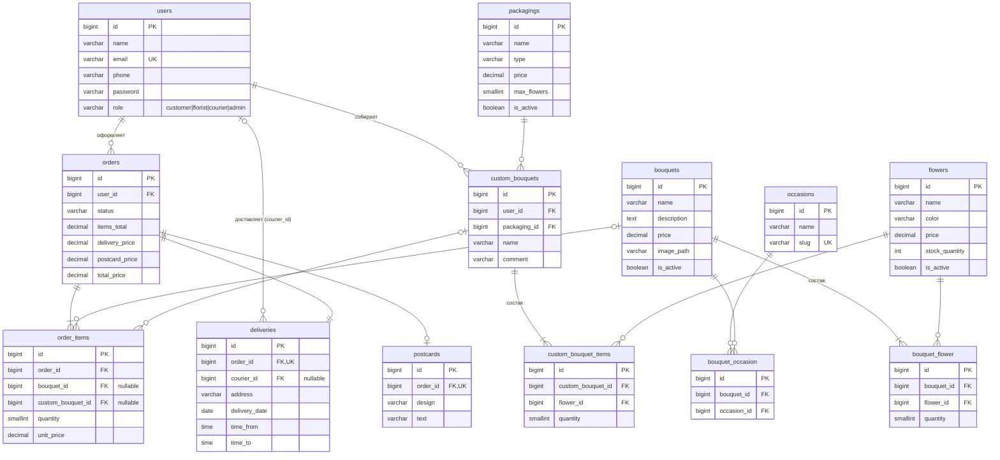

# Модель данных

## 1. Сущности

| Модель | Таблица | Описание | Основные атрибуты | Связи (Eloquent) |
|--------|---------|----------|-------------------|------------------|
| User | users | Пользователь любой роли | name, email, phone, password (хеш), role | hasMany Order; hasMany CustomBouquet; hasMany Delivery (как курьер, `courier_id`) |
| Occasion | occasions | Повод (справочник) | name, slug | belongsToMany Bouquet |
| Flower | flowers | Цветок — единица складского учёта | name, color, price, stock_quantity, is_active | belongsToMany Bouquet (pivot quantity); hasMany CustomBouquetItem |
| Packaging | packagings | Упаковка для конструктора | name, type, color, price, max_flowers, is_active | hasMany CustomBouquet |
| Bouquet | bouquets | Готовый букет каталога | name, description, price, image_path, is_active | belongsToMany Flower; belongsToMany Occasion; hasMany OrderItem |
| CustomBouquet | custom_bouquets | Индивидуальный букет из конструктора | user_id, packaging_id, name, comment | belongsTo User; belongsTo Packaging; hasMany CustomBouquetItem; belongsToMany Flower (через custom_bouquet_items) |
| CustomBouquetItem | custom_bouquet_items | Позиция индивидуального букета | custom_bouquet_id, flower_id, quantity | belongsTo CustomBouquet; belongsTo Flower |
| Order | orders | Заказ | user_id, status, items_total, delivery_price, postcard_price, total_price | belongsTo User; hasMany OrderItem; hasOne Delivery; hasOne Postcard |
| OrderItem | order_items | Позиция заказа | order_id, bouquet_id \| custom_bouquet_id, quantity, unit_price | belongsTo Order; belongsTo Bouquet; belongsTo CustomBouquet |
| Delivery | deliveries | Доставка заказа | order_id, courier_id, address, recipient, delivery_date, time_from, time_to | belongsTo Order; belongsTo User (courier) |
| Postcard | postcards | Открытка к заказу | order_id, design, text, signature | belongsTo Order |

Промежуточные таблицы «многие ко многим»: **bouquet_flower** (состав букета, с количеством), **bouquet_occasion**.
Таблица **custom_bouquet_items** также реализует связь «многие ко многим» CustomBouquet ⇄ Flower с дополнительным полем.

### Обязательность связей

| Связь | Тип | Обязательность |
|-------|-----|----------------|
| User — Order | 1 : N | заказ без покупателя не существует; у пользователя может не быть заказов |
| Order — OrderItem | 1 : N | в заказе минимум одна позиция |
| Order — Delivery | 1 : 1 | у каждого заказа ровно одна доставка |
| Order — Postcard | 1 : 0..1 | открытка необязательна |
| User (курьер) — Delivery | 1 : N | курьер может быть не назначен (`courier_id` NULL) |
| Bouquet — Flower | M : N | у букета минимум один цветок; цветок может не входить в букеты |
| Bouquet — Occasion | M : N | необязательна с обеих сторон |
| CustomBouquet — Flower | M : N (через items) | у индивидуального букета минимум один цветок |
| Packaging — CustomBouquet | 1 : N | у индивидуального букета обязательна упаковка |
| OrderItem — Bouquet / CustomBouquet | N : 1 | ровно одна из двух ссылок заполнена |

## 2. ER-диаграмма (нотация Crow's Foot)

Во всех таблицах также есть `created_at` и `updated_at` (`$table->timestamps()`).

## 3. Проверка модели на ключевом сценарии

1. Каталог: `bouquets` + `bouquet_occasion` (фильтр по поводу) + `bouquet_flower` (фильтр по цветам, цвет — `flowers.color`).
2. Конструктор: цены цветов — `flowers.price`, упаковка — `packagings.price`, вместимость — `packagings.max_flowers`; сохранённый состав — `custom_bouquet_items`.
3. Заказ: потребность в цветах вычисляется по `bouquet_flower` и `custom_bouquet_items`, остатки — `flowers.stock_quantity`.
4. Фиксация цены на момент заказа — `order_items.unit_price`, итог — `orders.*_price`.
5. Доставка и открытка — `deliveries`, `postcards`; курьер — `deliveries.courier_id → users`.
6. Статус и история — `orders.status`, `orders.cancelled_at`, `deliveries.delivered_at`.

## 4. Нормализация (3НФ)

- **1НФ:** все поля атомарны; состав букета вынесен в отдельные строки `bouquet_flower`, а не хранится списком.
- **2НФ:** в промежуточных таблицах (`bouquet_flower`, `custom_bouquet_items`) неключевой атрибут `quantity` зависит от всей пары внешних ключей.
- **3НФ:** нет транзитивных зависимостей. Изменения при нормализации:
  - цена индивидуального букета **не хранится** — вычисляется по составу и упаковке (`CustomBouquet::price()`);
  - данные доставки и открытки вынесены в `deliveries` и `postcards` (1:1), чтобы не держать в `orders` необязательные поля;
  - роль, статусы, тип упаковки, цвет хранятся кодом; подписи — в PHP Enum.
- **Осознанная денормализация:** `order_items.unit_price` и суммы в `orders` — исторический снимок цены (цены в каталоге могут измениться), а не дублирование.

## 5. Физическая модель — описание таблиц

### users
| Поле | Тип MySQL | Метод Laravel | Ограничения | Назначение |
|------|-----------|---------------|-------------|------------|
| id | BIGINT UNSIGNED | `id()` | PK | |
| name | VARCHAR(255) | `string('name')` | NOT NULL | Имя |
| email | VARCHAR(255) | `string('email')->unique()` | NOT NULL, UNIQUE | Логин |
| phone | VARCHAR(20) | `string('phone', 20)->nullable()` | NULL | Телефон |
| email_verified_at | TIMESTAMP | `timestamp(...)->nullable()` | NULL | |
| password | VARCHAR(255) | `string('password')` | NOT NULL | Хеш bcrypt |
| role | VARCHAR(20) | `string('role', 20)->default('customer')->index()` | NOT NULL, DEFAULT 'customer', INDEX | Роль (Enum UserRole) |
| remember_token | VARCHAR(100) | `rememberToken()` | NULL | |

### flowers
| Поле | Тип MySQL | Метод Laravel | Ограничения | Назначение |
|------|-----------|---------------|-------------|------------|
| id | BIGINT UNSIGNED | `id()` | PK | |
| name | VARCHAR(100) | `string('name', 100)->index()` | NOT NULL, INDEX, UNIQUE (в приложении) | Название |
| color | VARCHAR(20) | `string('color', 20)->index()` | NOT NULL, INDEX | Цвет (Enum FlowerColor) |
| price | DECIMAL(10,2) | `decimal('price', 10, 2)` | NOT NULL, > 0 (в приложении) | Цена за штуку |
| stock_quantity | INT UNSIGNED | `unsignedInteger('stock_quantity')->default(0)` | NOT NULL, ≥ 0 | Остаток |
| description | TEXT | `text('description')->nullable()` | NULL | |
| is_active | BOOLEAN | `boolean('is_active')->default(true)->index()` | INDEX | В продаже |

### packagings
| Поле | Тип MySQL | Метод Laravel | Ограничения | Назначение |
|------|-----------|---------------|-------------|------------|
| id | BIGINT UNSIGNED | `id()` | PK | |
| name | VARCHAR(100) | `string('name', 100)` | NOT NULL | |
| type | VARCHAR(20) | `string('type', 20)->default('paper')` | NOT NULL | Enum PackagingType |
| color | VARCHAR(50) | `string('color', 50)->nullable()` | NULL | |
| price | DECIMAL(10,2) | `decimal('price', 10, 2)->default(0)` | ≥ 0 | |
| max_flowers | SMALLINT UNSIGNED | `unsignedSmallInteger('max_flowers')->default(51)` | 3..201 | Вместимость |
| is_active | BOOLEAN | `boolean('is_active')->default(true)->index()` | INDEX | |

### bouquets
| Поле | Тип MySQL | Метод Laravel | Ограничения | Назначение |
|------|-----------|---------------|-------------|------------|
| id | BIGINT UNSIGNED | `id()` | PK | |
| name | VARCHAR(150) | `string('name', 150)->index()` | NOT NULL, INDEX | Поиск |
| description | TEXT | `text('description')->nullable()` | NULL | |
| price | DECIMAL(10,2) | `decimal('price', 10, 2)->index()` | NOT NULL, > 0, INDEX | Фильтр по цене |
| image_path | VARCHAR(255) | `string('image_path')->nullable()` | NULL | Путь в Storage |
| is_active | BOOLEAN | `boolean('is_active')->default(true)->index()` | INDEX | |

### bouquet_flower, bouquet_occasion, custom_bouquet_items
| Поле | Метод Laravel | Ограничения |
|------|---------------|-------------|
| bouquet_id | `foreignId('bouquet_id')->constrained()->cascadeOnDelete()` | удаление букета удаляет состав |
| flower_id | `foreignId('flower_id')->constrained()->restrictOnDelete()` | нельзя удалить цветок из состава букетов (409) |
| occasion_id | `foreignId('occasion_id')->constrained()->cascadeOnDelete()` | |
| custom_bouquet_id | `foreignId(...)->constrained()->cascadeOnDelete()` | |
| quantity | `unsignedSmallInteger('quantity')` | NOT NULL, ≥ 1 |
| — | `unique(['bouquet_id', 'flower_id'])` и аналогичные | цветок в составе один раз |

### custom_bouquets
| Поле | Метод Laravel | Ограничения |
|------|---------------|-------------|
| user_id | `foreignId('user_id')->constrained()->cascadeOnDelete()` | |
| packaging_id | `foreignId('packaging_id')->constrained('packagings')->restrictOnDelete()` | упаковку в использовании не удалить — отключается `is_active` |
| name | `string('name', 100)` | NOT NULL |
| comment | `string('comment', 500)->nullable()` | |

### orders
| Поле | Тип MySQL | Метод Laravel | Ограничения |
|------|-----------|---------------|-------------|
| user_id | BIGINT UNSIGNED | `foreignId('user_id')->constrained()->restrictOnDelete()` | история продаж сохраняется |
| status | VARCHAR(20) | `string('status', 20)->default('new')->index()` | Enum OrderStatus, INDEX |
| items_total, delivery_price, postcard_price, total_price | DECIMAL(10,2) | `decimal(..., 10, 2)` | ≥ 0 |
| comment | VARCHAR(500) | `string('comment', 500)->nullable()` | |
| cancelled_at | TIMESTAMP | `timestamp('cancelled_at')->nullable()` | |
| created_at | TIMESTAMP | `timestamps()` + `index('created_at')` | INDEX (отчёты) |

### order_items
| Поле | Метод Laravel | Ограничения |
|------|---------------|-------------|
| order_id | `foreignId('order_id')->constrained()->cascadeOnDelete()` | |
| bouquet_id | `foreignId('bouquet_id')->nullable()->constrained()->restrictOnDelete()` | заказанный букет не удалить — снять с продажи |
| custom_bouquet_id | `foreignId('custom_bouquet_id')->nullable()->constrained()->restrictOnDelete()` | ровно одно из двух (в приложении) |
| quantity | `unsignedSmallInteger('quantity')->default(1)` | 1..20 |
| unit_price | `decimal('unit_price', 10, 2)` | цена на момент заказа |

### deliveries
| Поле | Метод Laravel | Ограничения |
|------|---------------|-------------|
| order_id | `foreignId('order_id')->unique()->constrained()->cascadeOnDelete()` | 1:1 |
| courier_id | `foreignId('courier_id')->nullable()->constrained('users')->nullOnDelete()` | при удалении курьера доставка становится неназначенной |
| address / recipient_name / recipient_phone | `string(...)` | NOT NULL |
| delivery_date | `date('delivery_date')->index()` | не в прошлом, ≤ 30 дней (в приложении); INDEX |
| time_from, time_to | `time(...)` | 09:00–21:00, `time_to > time_from`, ≥ 60 мин (в приложении) |
| delivered_at | `timestamp('delivered_at')->nullable()` | |

### postcards
| Поле | Метод Laravel | Ограничения |
|------|---------------|-------------|
| order_id | `foreignId('order_id')->unique()->constrained()->cascadeOnDelete()` | 1:1 |
| design | `string('design', 20)->default('classic')` | Enum PostcardDesign |
| text | `string('text', 500)` | NOT NULL |
| signature | `string('signature', 100)->nullable()` | |

## 6. Индексы

Помимо первичных ключей, уникальных и внешних ключей:
`users.role`, `flowers.name`, `flowers.color`, `flowers.is_active`, `bouquets.name`, `bouquets.price`,
`bouquets.is_active`, `packagings.is_active`, `orders.status`, `orders.created_at`, `deliveries.delivery_date`.
Индексы созданы только для полей поиска, фильтрации и сортировки — каждый индекс замедляет вставку и занимает место.

## 7. Перечисления (PHP Enum)

| Enum | Значения |
|------|----------|
| UserRole | customer, florist, courier, admin |
| OrderStatus | new, assembling, ready, delivering, delivered, cancelled |
| FlowerColor | red, white, pink, yellow, orange, purple, blue, green, mixed |
| PackagingType | paper, film, box, basket |
| PostcardDesign | classic, romantic, birthday, minimal |

## 8. Правила, проверяемые на уровне приложения

- цена букета и цветка > 0; остаток не может стать отрицательным;
- дата доставки — не в прошлом и не дальше 30 дней; `time_to > time_from`; интервал в рабочих часах и ≥ 60 минут; начало ≥ now + 3 ч;
- в индивидуальном букете ≥ 3 цветов, не больше вместимости упаковки, количество нечётное;
- в позиции заказа заполнен ровно один из `bouquet_id` / `custom_bouquet_id`;
- статус заказа меняется только по допустимым переходам.
